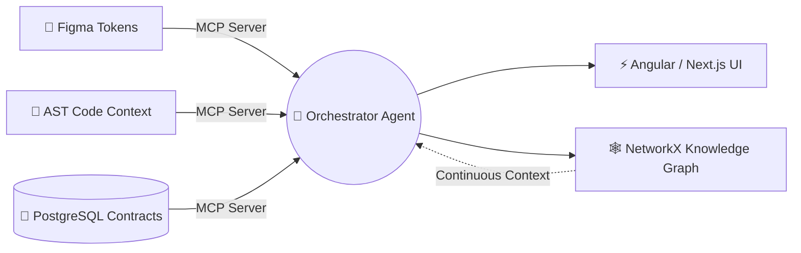

<div align="center">

# ⚡ Arya Das
### Full-Stack & AI Systems Engineer · Associate Software Developer @ PwC

<p align="center">
  <a href="https://www.linkedin.com/in/arya-das-141747226" target="_blank"></a>
  <a href="mailto:arya.das512ht@gmail.com"></a>
  <a href="https://instagram.com/aryadas_11" target="_blank"></a>
  <a href="https://t.me/nothing1650" target="_blank"></a>
  
</p>

<!-- Interactive Quick-Jump Navigation -->
<kbd><a href="#-system-identity">⚡ Identity</a></kbd> ·
<kbd><a href="#️-tech-arsenal">🛠️ Tech Arsenal</a></kbd> ·
<kbd><a href="#-agentic-architecture">🧠 Agentic Workflow</a></kbd> ·
<kbd><a href="#-engineering-case-studies">🚀 Case Studies</a></kbd> ·
<kbd><a href="#-github-telemetry">📊 Telemetry</a></kbd>

</div>

---

> [!TIP]
> **Current Engineering Focus:** Architecting enterprise **Angular 18+ / NX Monorepo** portals for **23.4M+ citizens** and building **Multi-Agent Claude AI & Model Context Protocol (MCP)** developer ecosystems that accelerate SDLC delivery by **50%**.

---

## ⚡ System Identity

```tsx
const aryaDas: SoftwareEngineer = {
  pronouns: "He" | "Him",
  location: "Kolkata, India 🇮🇳",
  role: "Associate Software Developer & Technical Consultant @ PwC",
  education: "B.Tech in CSE — Heritage Institute of Technology ('24) [8.69 CGPA]",
  certifications: ["Claude AI Architect", "Claude AI Developer"],
  specialties: [
    "Micro-Frontends & Reactive State (Angular 18+, Next.js, NgRx, RxJS)",
    "Autonomous AI Agents, Custom MCP Servers & NetworkX Knowledge Graphs",
    "High-Scale Data Pipelines (Node.js, PostgreSQL, PL/pgSQL, Power BI)"
  ],
  offTheClock: "Trekking high-altitude Himalayan trails 🏔️ & open-source tinkering"
};
```

---

## 🛠️ Tech Arsenal

<div align="center">
  &nbsp;&nbsp;
  &nbsp;&nbsp;
  &nbsp;&nbsp;
  &nbsp;&nbsp;
  &nbsp;&nbsp;
  &nbsp;&nbsp;
  &nbsp;&nbsp;
  &nbsp;&nbsp;
  &nbsp;&nbsp;
  &nbsp;&nbsp;
  &nbsp;&nbsp;
  &nbsp;&nbsp;
  &nbsp;&nbsp;
  &nbsp;&nbsp;
  &nbsp;&nbsp;
  &nbsp;&nbsp;
  
</div>

<br/>

<table>
  <tr>
    <td width="50%" valign="top">
      <h4>🎨 Frontend & Monorepo Engineering</h4>
      <p>
        
        
        
        
        
        
        
      </p>
    </td>
    <td width="50%" valign="top">
      <h4>🤖 Agentic AI & Systems Tooling</h4>
      <p>
        
        
        
        
        
        
      </p>
    </td>
  </tr>
  <tr>
    <td width="50%" valign="top">
      <h4>⚙️ Backend & Data Infrastructure</h4>
      <p>
        
        
        
        
        
        
      </p>
    </td>
    <td width="50%" valign="top">
      <h4>☁️ Cloud, DevOps & Delivery</h4>
      <p>
        
        
        
        
        
      </p>
    </td>
  </tr>
</table>

---

## 🧠 Agentic Architecture

> *Interactive Mermaid diagram — use the top-right controls on hover to pan, zoom, and inspect how I wire AI-native SDLC pipelines:*



---

## 🚀 Engineering Case Studies

> 👇 **Click any card below to expand architecture & production metrics:**

<details open>
  <summary><b>🏛️ Enterprise Public-Sector Portals @ PwC — 23.4M+ Citizens | 38% Smaller Bundles</b></summary>
  <br/>
  <blockquote>
    <ul>
      <li><b>DGH Portal Modernization:</b> Spearheaded frontend modernization using <b>Angular 18, TypeScript, and NX Monorepo</b>, building modular UI libraries, dynamic nested reactive forms, and lazy-loaded routes to cut bundle size by <b>38%</b>.</li>
      <li><b>Assam Govt DIDS Portal:</b> Scaled high-traffic UI rendering for <b>23.4M+ citizens</b> (INR 350 Cr monthly disbursements) with race-condition-free <b>NgRx & RxJS</b> state, RBAC, and AES document encryption.</li>
      <li><b>AI Document Intelligence & BI:</b> Deployed automated compliance summarization and filing validation pipelines paired with embedded <b>Power BI</b> executive dashboards and optimized <b>PL/pgSQL Stored Procedures</b>.</li>
    </ul>
  </blockquote>
</details>

<details>
  <summary><b>🤖 Multi-Agent Claude Ecosystem & Custom MCP Servers — 50% Faster SDLC</b></summary>
  <br/>
  <blockquote>
    <ul>
      <li>Engineered custom <b>Model Context Protocol (MCP)</b> servers interfacing Figma design tokens, AST code context, and PostgreSQL schema contracts for automated full-stack scaffolding.</li>
      <li>Orchestrated specialized microservice sub-agents backed by a <b>Python NetworkX knowledge graph</b> and auto-maintained Markdown documentation.</li>
    </ul>
  </blockquote>
</details>

<details>
  <summary><b>⚡ Selected Open-Source & Full-Stack Builds</b></summary>
  <br/>
  <table>
    <tr>
      <th align="left">Project</th>
      <th align="left">Architecture & Impact</th>
    </tr>
    <tr>
      <td><b>🔗 LoopLink</b></td>
      <td>Full-stack AI social platform featuring infinite scroll, real-time messaging, AI Vision image captioning, and <code>React + Node.js + Appwrite</code>.</td>
    </tr>
    <tr>
      <td><b>⚡ Riddhi Siddhi Portal</b></td>
      <td>Commercial SSR/SSG web application built with <code>Next.js</code>, <code>Tailwind CSS</code>, and structured JSON-LD Schema for high-ranking Technical SEO.</td>
    </tr>
    <tr>
      <td><b>🎙️ Bird Sound Classifier</b></td>
      <td><b>🏆 Hack Heritage '23 Honorable Mention:</b> Deep learning bio-acoustic classifier built with <code>Python</code>, <code>TensorFlow/MobileNet</code>, and <code>React Web Audio API</code>.</td>
    </tr>
  </table>
</details>

---

## 📊 GitHub Telemetry

<div align="center">
  
</div>

<div align="center">
  
  
</div>

---

<div align="center">
  <sub>Built with ⚡ by <b>Arya Das</b> · Always down to collaborate on <b>Agentic AI, Distributed Frontends & System Design</b> · <a href="https://www.linkedin.com/in/arya-das-141747226">Let's connect on LinkedIn ↗</a></sub>
</div>
