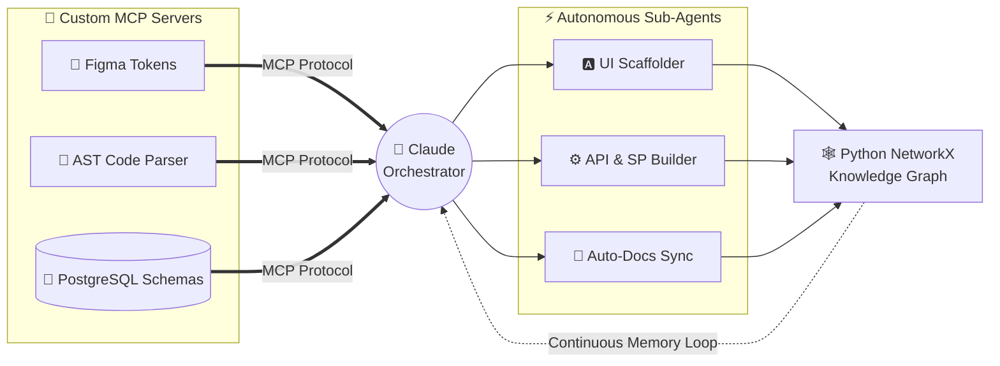
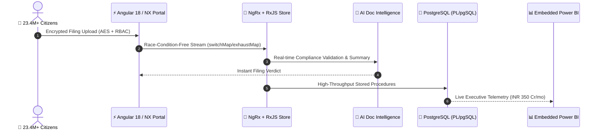

<a id="readme-top"></a>

<div align="center">

  <!-- Animated Developer Hero (Pre-cached on GitHub Camo CDN - Zero Timeout) -->
  

  <h1>⚡ Arya Das</h1>

  <!-- Animated Live Typing Terminal (Heroku Instance - High Reliability) -->
  <a href="https://www.linkedin.com/in/arya-das-141747226">
    
  </a>

  <!-- Live Status & Social Dock -->
  <p align="center">
    <a href="https://www.linkedin.com/in/arya-das-141747226" target="_blank"></a>
    <a href="mailto:arya.das512ht@gmail.com"></a>
    <a href="https://instagram.com/aryadas_11" target="_blank"></a>
    <a href="https://t.me/nothing1650" target="_blank"></a>
    
  </p>

  <!-- Interactive Command Navigation Bar -->
  <p>
    <kbd><a href="#-live-terminal">💻 Terminal</a></kbd> &nbsp;
    <kbd><a href="#️-tech-arsenal">🛠️ Tech Arsenal</a></kbd> &nbsp;
    <kbd><a href="#-interactive-system-blueprints">🧠 System Blueprints</a></kbd> &nbsp;
    <kbd><a href="#-impact-showcase">🚀 Impact Showcase</a></kbd> &nbsp;
    <kbd><a href="#-live-telemetry">📊 Telemetry</a></kbd>
  </p>

  <!-- Animated RGB Neon Divider -->
  

</div>

> [!IMPORTANT]
> **🟢 CURRENTLY SHIPPING:** Modernizing mission-critical enterprise portals at **PwC** (**38% smaller bundles** | **23.4M+ active citizens**) while engineering **Multi-Agent Claude AI & Model Context Protocol (MCP)** pipelines that cut SDLC delivery time by **50%**.

---

## 💻 Live Terminal

```ts
// arya.config.ts — Hover to copy or inspect system state
export const EngineerProfile = {
  name: "Arya Das",
  role: "Associate Software Developer & Technical Consultant @ PwC",
  base: "Kolkata, India 🇮🇳",
  almaMater: "B.Tech CSE — Heritage Institute of Technology ('24) [8.69 CGPA]",
  credentials: ["Claude AI Architect", "Claude AI Developer"],

  impactMetrics: {
    activeCitizensServed: "23.4M+ (INR 350 Cr/mo disbursements)",
    frontendBundleReduction: "-38% via NX Monorepo & Lazy Architecture",
    aiSdlcAcceleration: "+50% velocity via Custom MCP Servers & Agents",
  },

  offTheClock: ["Himalayan High-Altitude Trekking 🏔️", "System Design", "Open Source"]
} as const;
```

<details>
  <summary>🕹️ <b>Interactive CLI: Click to run <code>$ whoami --verbose</code></b></summary>
  <br/>

  ```diff
  + [2024 - Present] PwC — Associate Software Developer & Technical Consultant
  !   ├── Frontend Lead on DGH & Assam Govt DIDS Portals (Angular 18+, NgRx, RxJS)
  !   ├── Engineered Custom MCP Servers (Figma + AST + PostgreSQL Schema Contracts)
  !   └── Deployed AI Document Intelligence + Embedded Power BI Executive Dashboards

  + [Summer 2023] Alumnus Software Ltd. — Software Engineering Intern
  !   └── Boosted low-light biometric OpenCV detection precision by +15%

  + [2020 - 2024] Heritage Institute of Technology — B.Tech in CSE (8.69/10.0)
  !   └── 🏆 Honorable Mention @ Hack Heritage '23 (Deep Learning Bio-Acoustics)
  ```
</details>

<div align="right"><kbd><a href="#readme-top">↑ Top</a></kbd></div>


## 🛠️ Tech Arsenal

> 💡 *Hover over any icon below to inspect the tool, or toggle the domain drawers underneath:*

<div align="center">
  <a href="#️-tech-arsenal"></a>&nbsp;&nbsp;
  <a href="#️-tech-arsenal"></a>&nbsp;&nbsp;
  <a href="#️-tech-arsenal"></a>&nbsp;&nbsp;
  <a href="#️-tech-arsenal"></a>&nbsp;&nbsp;
  <a href="#️-tech-arsenal"></a>&nbsp;&nbsp;
  <a href="#️-tech-arsenal"></a>&nbsp;&nbsp;
  <a href="#️-tech-arsenal"></a>&nbsp;&nbsp;
  <a href="#️-tech-arsenal"></a>&nbsp;&nbsp;
  <a href="#️-tech-arsenal"></a>&nbsp;&nbsp;
  <a href="#️-tech-arsenal"></a>&nbsp;&nbsp;
  <a href="#️-tech-arsenal"></a>&nbsp;&nbsp;
  <a href="#️-tech-arsenal"></a>&nbsp;&nbsp;
  <a href="#️-tech-arsenal"></a>&nbsp;&nbsp;
  <a href="#️-tech-arsenal"></a>&nbsp;&nbsp;
  <a href="#️-tech-arsenal"></a>&nbsp;&nbsp;
  <a href="#️-tech-arsenal"></a>&nbsp;&nbsp;
  <a href="#️-tech-arsenal"></a>
</div>

<br/>

<table>
  <tr>
    <td width="50%" valign="top">
      <h4 align="center">🎨 Frontend & Reactive State</h4>
      <p align="center">
        
        
        
        
        
        
      </p>
    </td>
    <td width="50%" valign="top">
      <h4 align="center">🤖 Agentic AI & Protocols</h4>
      <p align="center">
        
        
        
        
        
        
      </p>
    </td>
  </tr>
  <tr>
    <td width="50%" valign="top">
      <h4 align="center">⚙️ Backend & Data Pipelines</h4>
      <p align="center">
        
        
        
        
        
        
      </p>
    </td>
    <td width="50%" valign="top">
      <h4 align="center">☁️ Cloud, DevOps & Consulting</h4>
      <p align="center">
        
        
        
        
        
      </p>
    </td>
  </tr>
</table>

<details>
  <summary>📈 <b>Click to inspect Domain Focus & Allocation Matrix</b></summary>
  <br/>

  ```text
  Enterprise Frontend (Angular / Next.js / NX)   ████████████████████░░  92%
  Agentic AI, MCP Servers & RAG Orchestration    ██████████████████░░░░  88%
  Backend & Database Architecture (Node / PG)    █████████████████░░░░░  85%
  Cloud, CI/CD & Forward-Deployed Consulting     ████████████████░░░░░░  80%
  ```
</details>

<div align="right"><kbd><a href="#readme-top">↑ Top</a></kbd></div>


## 🧠 Interactive System Blueprints

> 🖱️ **Interactive Canvas:** Hover over the diagram to reveal GitHub's native **Zoom, Pan & Fullscreen** controls! Toggle the second tab to explore the Enterprise Portal architecture.

<details open>
  <summary><b>🤖 Blueprint 01: Multi-Agent Claude & Custom MCP Ecosystem (Open)</b></summary>
  <br/>


</details>

<details>
  <summary><b>🏛️ Blueprint 02: High-Traffic Citizen Portal Architecture (23.4M+ Users)</b></summary>
  <br/>


</details>

<div align="right"><kbd><a href="#readme-top">↑ Top</a></kbd></div>


## 🚀 Impact Showcase

> 👇 **Click any milestone card to expand technical deep-dives:**

<details open>
  <summary><b>🏛️ PwC — Public-Sector Digital Infrastructure (DGH & Assam Govt DIDS)</b></summary>
  <br/>
  <table>
    <tr>
      <td><b>📉 -38% Bundle Size</b></td>
      <td><b>👥 23.4M+ Citizens</b></td>
      <td><b>💰 ₹350 Cr/mo Load</b></td>
      <td><b>⚡ +50% SDLC Velocity</b></td>
    </tr>
  </table>
  <ul>
    <li><b>DGH Portal Modernization:</b> Engineered modular UI libraries, dynamic nested reactive forms, and lazy-loaded micro-routes with <code>Angular 18</code>, <code>TypeScript</code>, and <code>NX Monorepo</code>.</li>
    <li><b>Reactive State & Security:</b> Built race-condition-free state pipelines using <code>NgRx</code> & <code>RxJS</code>, enforcing strict <b>RBAC</b> and <b>AES encryption</b> for government compliance.</li>
    <li><b>AI + Executive Analytics:</b> Deployed an automated AI Document Intelligence compliance pipeline paired with embedded <b>Power BI</b> dashboards and optimized <code>PL/pgSQL</code> stored procedures.</li>
  </ul>
</details>

<details>
  <summary><b>🔗 LoopLink — AI-Native Real-Time Social Platform</b></summary>
  <br/>
  <ul>
    <li><b>Stack:</b> <code>React.js</code> · <code>Node.js</code> · <code>Appwrite</code> · <code>AI Vision APIs</code> · <code>Tailwind CSS</code></li>
    <li>Engineered infinite-scroll feeds, real-time messaging channels, and automated AI-driven image captioning.</li>
  </ul>
</details>

<details>
  <summary><b>⚡ Riddhi Siddhi Electricals — High-SEO SSR Web Platform</b></summary>
  <br/>
  <ul>
    <li><b>Stack:</b> <code>Next.js (SSR/SSG)</code> · <code>React.js</code> · <code>Tailwind CSS</code> · <code>JSON-LD Schema</code></li>
    <li>Architected fast server-rendered commercial pages with structured metadata for top-tier Core Web Vitals and organic search visibility.</li>
  </ul>
</details>

<details>
  <summary><b>🎙️ Bio-Acoustic Bird Classifier — 🏆 Hack Heritage '23 Honorable Mention</b></summary>
  <br/>
  <ul>
    <li><b>Stack:</b> <code>Python</code> · <code>TensorFlow / Keras</code> · <code>MobileNet</code> · <code>React Web Audio API</code></li>
    <li>Built an end-to-end spectrogram audio classification pipeline capable of real-time species recognition in the browser.</li>
  </ul>
</details>

<div align="right"><kbd><a href="#readme-top">↑ Top</a></kbd></div>


## 📊 Live Telemetry

<div align="center">
  
</div>

<div align="center">
  
  
</div>


<div align="center">
  <!-- Animated Footer Typing Loop -->
  <a href="https://www.linkedin.com/in/arya-das-141747226">
    
  </a>
  <br/>
  <kbd><a href="#readme-top">🚀 Back to Top</a></kbd>
</div>
